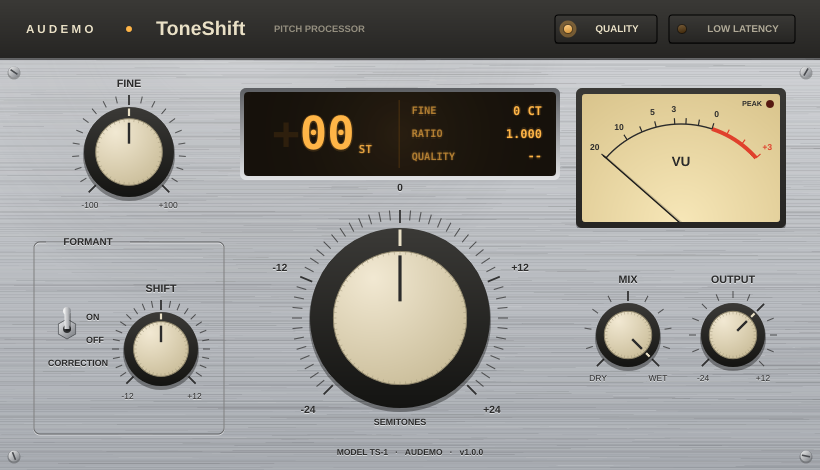

# ToneShift by Audemo

ToneShift is a pitch shifter plugin with formant correction. It moves audio up or
down by up to two octaves, keeps voices sounding natural, and offers a
zero-latency mode for live use.

**Formats:** VST3, AU (macOS), LV2 (Linux), Standalone
**Author and main contributor:** zgodet (see [AUTHORS](AUTHORS))



## Features

- **Pitch:** ±24 semitones, plus ±100 cents fine tuning.
- **Two engines:**
  - **Quality:** a phase-vocoder engine. Phases are locked to spectral peaks, so
    the sound stays clear without the usual "phasey" smear. Latency is
    about 43 ms and is reported to the host, so it is compensated automatically.
  - **Low Latency:** a time-domain engine with no added latency. Splice points
    are chosen by cross-correlation so the waveform stays continuous. Good for
    live monitoring and tracking.
- **Formant correction** (Quality mode): keeps the original vocal character
  when you change pitch, so you don't get chipmunk or giant voices. **Shift**
  moves the formants on their own (±12 st) for gender and character effects.
- **Mix:** dry/wet blend. The dry signal is delayed to line up with the wet
  signal, so parallel blends don't comb-filter.
- **Output:** -24 to +12 dB, with an analogue-style VU meter and peak lamp.
- **Vintage hardware interface:** brushed-metal faceplate, cream knobs with
  printed scales, and an amber display that shows the pitch, ratio and latency,
  plus the value of any control while you move it.
- Every control is automatable. Double-click any knob to reset it.

## Controls

| Control    | Range              | Notes                                         |
|------------|--------------------|-----------------------------------------------|
| Pitch      | -24 … +24 st       | Whole semitones                               |
| Fine       | -100 … +100 ct     | Added to Pitch                                |
| Correction | on / off           | Formant correction (Quality mode only)        |
| Shift      | -12 … +12 st       | Formant shift, active when Correction is on   |
| Mode       | Quality / Low Latency |                                            |
| Mix        | 0 … 100 %          | Latency-aligned dry/wet                       |
| Output     | -24 … +12 dB       |                                               |

## Building

You need CMake 3.22+ and a C++17 compiler. JUCE 8 is downloaded automatically.

```bash
cmake -B build -DCMAKE_BUILD_TYPE=Release
cmake --build build --config Release
```

To use a JUCE checkout you already have:

```bash
cmake -B build -DTONESHIFT_JUCE_PATH=/path/to/JUCE
```

Built plugins are in `build/ToneShift_artefacts/Release/`.

- **macOS:** builds VST3, AU and Standalone. Use `-G Xcode` if you prefer Xcode.
- **Windows:** builds VST3 and Standalone with Visual Studio 2022.
- **Linux:** builds VST3, LV2 and Standalone. Install the JUCE dependencies first:
  ```bash
  sudo apt install libasound2-dev libx11-dev libxrandr-dev libxinerama-dev \
      libxcursor-dev libxext-dev libfreetype-dev libfontconfig1-dev libgl1-mesa-dev
  ```

## Tests

An offline test runner checks both engines on test tones: pitch accuracy,
level, and transparency at 0 st.

```bash
cmake --build build --target ToneShiftTests
./build/ToneShiftTests_artefacts/Release/ToneShiftTests
```

The plugin also passes [pluginval](https://github.com/Tracktion/pluginval) at
strictness level 10:

```bash
pluginval --strictness-level 10 build/ToneShift_artefacts/Release/VST3/ToneShift.vst3
```

## Project layout

```
Source/
  PluginProcessor.*      audio processing, latency, dry/wet, state
  PluginEditor.*         user interface
  Parameters.h           parameter definitions
  dsp/SpectralShifter.*  Quality engine (phase vocoder + formant correction)
  dsp/GrainShifter.*     Low Latency engine
  gui/AudemoLookAndFeel.h   vintage hardware styling
tests/DspTests.cpp       offline DSP checks
```

## How it works

**Quality engine.** Audio is split into overlapping 2048-sample frames (at
44.1/48 kHz; longer at higher rates) with a 4x overlap. For each frame the
engine finds spectral peaks, estimates each peak's true frequency from the
phase change between frames, and moves the whole region around each peak to
its new position. Each region's phases are locked to its peak, which keeps
harmonics coherent. For formant correction the engine estimates the spectral
envelope with a cepstrum and re-applies the original (or shifted) envelope
after the pitch move.

**Low Latency engine.** A read head moves through a short delay line at the
pitch ratio. When it drifts out of range, a second head starts at a position
found by cross-correlation with the audio just played, and the two heads are
crossfaded over 6 ms. The average delay is about 10–15 ms and nothing is
looked ahead, so the plugin reports zero latency.

## License

ToneShift is built on [JUCE](https://juce.com). To distribute builds you need
either a JUCE commercial license or to release ToneShift under the AGPLv3.
Choose a license for this project and add a `LICENSE` file before publishing.

© Audemo
